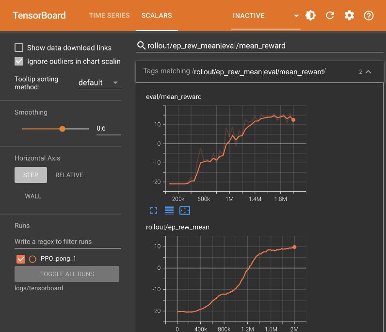

# Pong com PPO

Agente de aprendizado por reforço treinado para jogar Pong no Atari com **Proximal Policy Optimization (PPO)** e Stable Baselines3. O projeto compara uma política aleatória com uma política treinada e inclui o código, os resultados do experimento e as gravações das partidas.

## Resultados

| Avaliação | Partidas | Retorno médio |
| --- | ---: | ---: |
| Política aleatória | 5 | −20,4 |
| Melhor checkpoint do PPO | 10 | +13,6 |

O agente venceu **10 de 10 partidas** na avaliação final. O desvio-padrão dos retornos foi **3,2**. O retorno é o saldo entre pontos marcados e sofridos. A comparação é descritiva e usa amostras distintas. Na gravação separada, o agente treinado venceu por **21 a 16**.

O primeiro checkpoint com média de pelo menos **−5** apareceu aos **550 mil passos**, com média de **−2,2**, após **24min42s** no contador do treino. A execução completou **2.000.896 passos**. Os eventos do TensorBoard cobriram cerca de **9h35 de relógio**, enquanto o código registrou **1h26min54s**, incluindo avaliações.



## Vídeos e apresentação

| Material | Arquivo |
| --- | --- |
| Partida completa da política aleatória | [Vídeo MP4](videos/aleatorio/20261106_105137/aleatorio.mp4) |
| Partida completa do agente treinado | [Vídeo MP4](videos/treinado/20261106_202710/treinado.mp4) |
| Jogada inteligente entre 00:02 e 00:06 | [Trecho MP4](media/inteligente.mp4) |
| Jogada burra entre 00:26 e 00:28 | [Trecho MP4](media/burra.mp4) |
| Apresentação com 14 slides | [PowerPoint](docs/Pong_com_PPO.pptx) |
| Código, documentação e resultados | [Notebook Jupyter](Pong_RL.ipynb) |

No primeiro trecho, a raquete verde se posiciona para devolver a bola. No segundo, a bola passa acima da raquete verde e o Atari marca. Os tempos se referem à partida completa do agente treinado.

## Como rodar

Use **Python 3.12**. A execução registrada usou CPU e o notebook foi desenvolvido no Jupyter pelo VS Code.

```bash
git clone https://github.com/joao-castroo/pong-rl.git
cd pong-rl
python3.12 -m venv .venv
source .venv/bin/activate
python -m pip install -r requirements.txt
```

No Windows, crie o ambiente com `py -3.12 -m venv .venv` e ative com `\.venv\Scripts\Activate.ps1` no PowerShell.

### Jogar manualmente

```bash
python jogar.py
```

Use as **setas ↑ e ↓** ou **W e S** para mover a raquete da direita. **Espaço** aciona o botão e **Esc** encerra a sessão. O adversário é controlado pelo Atari. O script precisa de uma sessão gráfica e grava o resumo em `artifacts/sessao_humana.json`.

### Abrir o notebook ou repetir o treinamento

Abra `Pong_RL.ipynb` no VS Code com as extensões Python e Jupyter e selecione o interpretador de `.venv`. O notebook já contém as saídas do experimento. Para repetir a execução pelo terminal:

```bash
python executar_notebook.py
```

A execução atualiza o notebook e os arquivos de resultado. O treinamento usa cerca de dois milhões de passos e pode demorar várias horas dependendo da máquina. O checkpoint publicado está em `models/best_model.zip`. Para avaliar esse checkpoint no notebook, execute as células de configuração e de definição do ambiente e depois a célula da seção 9.

Durante ou após uma nova execução, abra o TensorBoard:

```bash
python -m tensorboard.main --logdir logs/tensorboard
```

Acesse `http://127.0.0.1:6006` e acompanhe `eval/mean_reward` e `rollout/ep_rew_mean`.

## Ambiente e agente

- **Ambiente:** `ALE/Pong-v5` do Gymnasium e ALE-py. A rede recebe quatro quadros consecutivos de 84 × 84 em escala de cinza.
- **Ações:** seis comandos discretos, incluindo ficar parado, subir, descer e combinações com o botão de ação.
- **Recompensas:** +1 ao marcar, −1 ao sofrer um ponto e 0 nos demais frames.
- **Treinamento:** PPO com política convolucional, oito ambientes, 128 passos por ambiente a cada rollout e batch de 256. A taxa de aprendizado foi 0,00025.
- **Rede:** três convoluções e uma camada densa compartilhadas entre a política e a estimativa de valor, somando **1.687.719 parâmetros treináveis**.
- **Bibliotecas:** Gymnasium e ALE-py para o ambiente, Stable Baselines3 e PyTorch para o agente, TensorBoard para métricas, Pygame para a sessão humana e ImageIO/FFmpeg para os vídeos.

Os valores do experimento estão em [artifacts/](artifacts/). A seção 6 do notebook compara os ajustes com o código original de Freeway.

## Referências

- [Enunciado da atividade](https://docs.google.com/document/d/1rRM9H1-KAUtVdBNzHf6zw3Ukkh3f3bMy/edit)
- [Notebook base de Freeway](https://drive.google.com/file/d/10liyDw_oMNjvP2N9g0IFz6nhaKWtpZc5/view)
- [Documentação do Pong no ALE](https://ale.farama.org/environments/pong/)
- [PPO no Stable Baselines3](https://stable-baselines3.readthedocs.io/en/master/modules/ppo.html)
